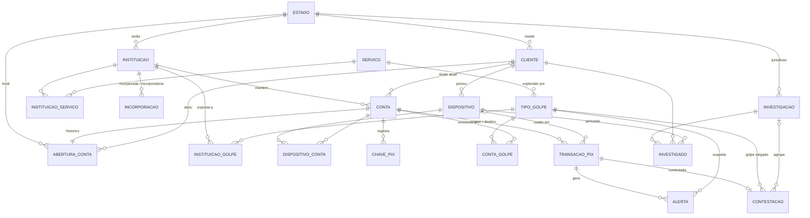

# PIX Antifraude: modelo relacional em PostgreSQL

Banco de dados de um **sistema de monitoramento de fraudes em transações PIX**: instituições financeiras, clientes, contas, chaves PIX, dispositivos, transações, alertas do motor antifraude, contestações (MED, o Mecanismo Especial de Devolução) e investigações.

O projeto foi feito para praticar SQL avançado sobre um domínio realista: junções múltiplas, agregações com `FILTER`, subconsultas correlacionadas e independentes, `EXISTS` / `NOT EXISTS`, divisão relacional, autorrelacionamento, `ROLLUP` / `GROUPING` e regras de integridade com triggers.

> Todos os dados são **fictícios**: nomes, CPFs, instituições e operações foram inventados e gerados de forma determinística.

## Como executar

Requisito: PostgreSQL 14 ou superior (testado no 16).

1. Crie um banco vazio (ex.: `pix`) no pgAdmin ou com `createdb pix`.
2. Abra o **Query Tool** e execute `01_criacao_pix_antifraude.sql`, que cria o schema, as tabelas, os índices e os triggers.
3. Execute `02_carga_pix_antifraude.sql`, que carrega os dados e se valida sozinho. Se alguma contagem ou regra falhar, a carga inteira é revertida.
4. Antes das consultas, rode:

```sql
SET search_path TO pix_antifraude;
```

Pela linha de comando:

```bash
psql -d pix -f 01_criacao_pix_antifraude.sql
psql -d pix -f 02_carga_pix_antifraude.sql
```

## Modelo de dados (19 tabelas)



| Grupo | Tabelas | Destaques |
|---|---|---|
| Sistema financeiro | `estado`, `instituicao`, `servico`, `instituicao_servico`, `incorporacao` | N:N entre instituições e serviços; **autorrelacionamento** de fusões e aquisições, com cadeias de 2 etapas |
| Clientes e contas | `cliente`, `conta`, `abertura_conta` | titular atual pode ser nulo; o histórico de abertura guarda **quem abriu**, que pode diferir do titular (sinal de conta laranja) |
| Catálogo de golpes | `tipo_golpe`, `instituicao_golpe`, `conta_golpe` | categorias ENGENHARIA_SOCIAL / TECNICO / DOCUMENTAL, com severidade |
| Segurança | `dispositivo`, `dispositivo_conta`, `chave_pix` | vínculos históricos (data de início e fim) |
| Transações | `transacao_pix`, `alerta` | 20 mil transações e 8 mil alertas do motor antifraude |
| Investigação | `investigacao`, `investigado`, `contestacao` | resultado da contestação: DEVOLVIDO / PARCIAL / NEGADO |

## Regras de integridade

Por constraints e índices:

- Valores de domínio garantidos por `CHECK`: status, categorias, score de 0 a 100, valor da transação maior que 0, origem diferente do destino.
- **Uma chave PIX não pode estar ativa em duas contas** (índice único parcial `WHERE data_exclusao IS NULL`).
- **Uma conta só fica autorizada em um dispositivo ativo por vez** (índice único parcial).
- FK composta: o dispositivo periciado numa investigação precisa pertencer ao próprio investigado.
- Exclusão de cliente → `SET NULL` no titular da conta, preservando o histórico.

Por triggers (PL/pgSQL):

1. No máximo **5 chaves PIX ativas por conta** (regra do Banco Central).
2. O dispositivo usado numa transação deve pertencer ao **titular da conta de origem**.
3. Consistência da contestação:
   - só transações concluídas podem ser contestadas, e nunca antes de acontecerem;
   - uma contestação concluída precisa ter resultado;
   - DEVOLVIDO devolve o valor total, PARCIAL devolve entre 0 e o valor, NEGADO devolve 0.

## Volume da carga

| Tabela | Registros | Tabela | Registros |
|---|---|---|---|
| estado | 10 | dispositivo | 480 |
| instituicao | 80 | dispositivo_conta | 1.979 |
| servico | 12 | chave_pix | 3.660 |
| instituicao_servico | 205 | transacao_pix | 20.000 |
| incorporacao | 18 | alerta | 8.000 |
| cliente | 400 | investigacao | 25 |
| conta | 1.800 | investigado | 500 |
| abertura_conta | 1.800 | contestacao | 1.461 |
| tipo_golpe | 30 | instituicao_golpe | 240 |
| conta_golpe | 575 | | |

A carga também planta casos de borda de propósito, para que as consultas tenham resultados interessantes:

- clientes sem conta;
- contas sem titular;
- instituições cujas contas nunca transacionaram;
- empates de severidade dentro de uma categoria de golpe;
- contas laranja que recebem muitas transações;
- vítimas com muitas contestações;
- investigações sem nenhuma contestação concluída.
